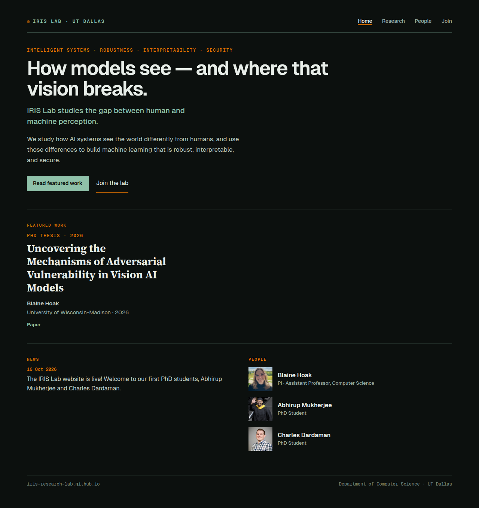
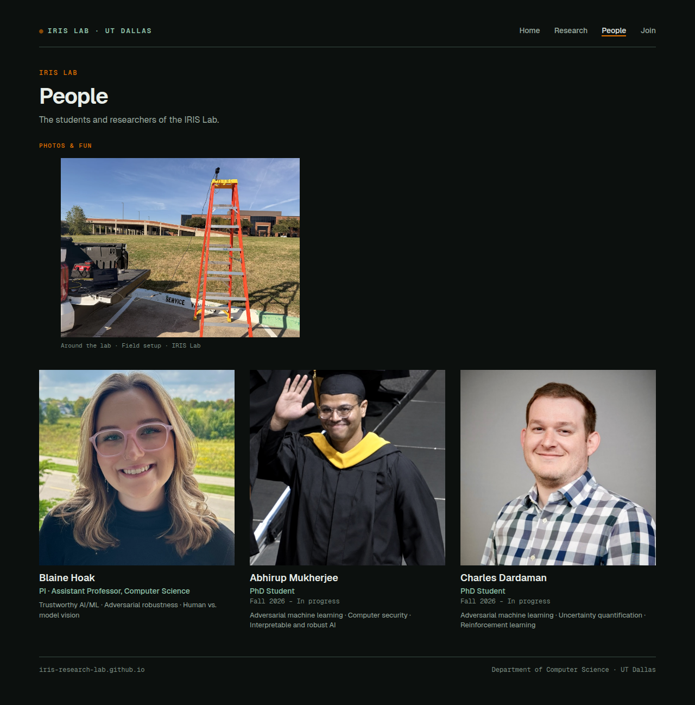
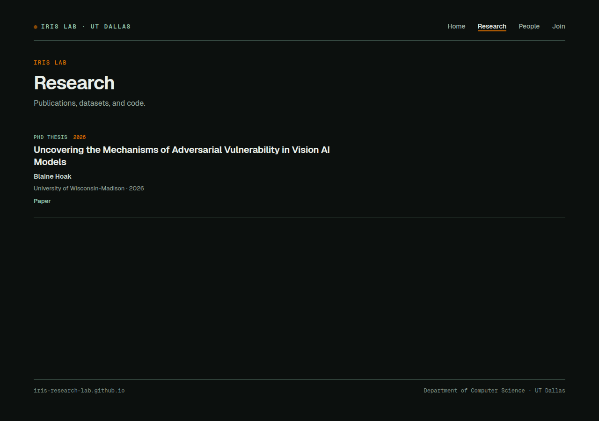
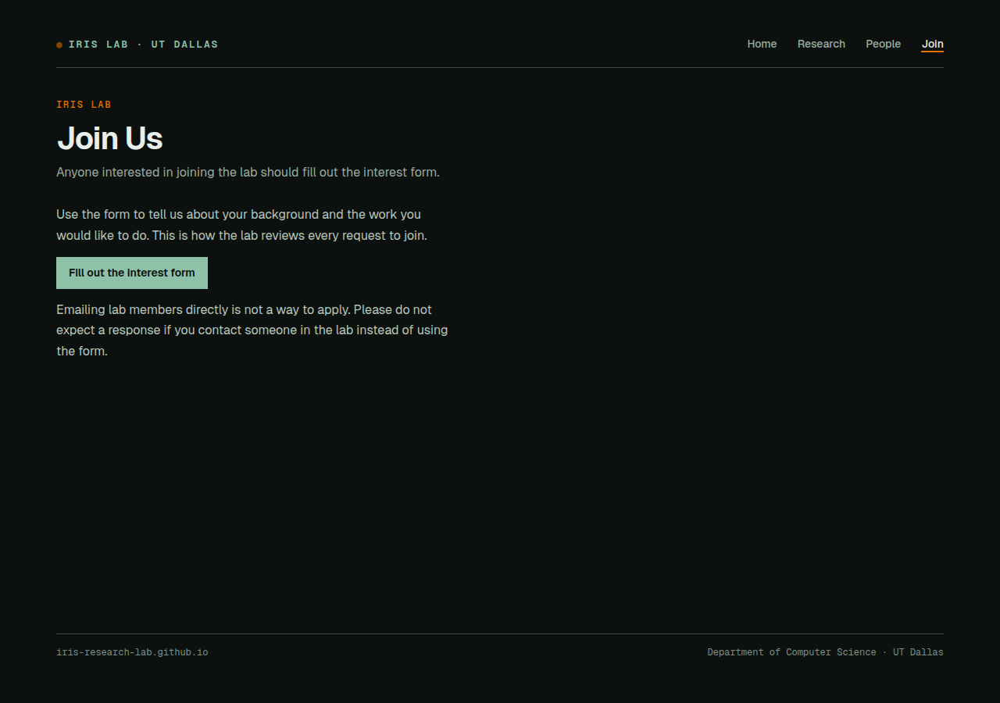

# PI feedback plan

## Shipped decisions (10 Nov 2026)

Charles approved this plan, then corrected the under-review papers. Where this note and the sections below disagree, this note is what the branch implements.

- Home bio is the draft below, in one paragraph in `index.html`.
- Join Us has no Google Form. The button is “Apply to UT Dallas” and goes to https://graduate-admissions.utdallas.edu/apply-to-ut-dallas/apply/ . The sentence is for prospective students generally.
- People is the roster only. Lab photos are on `/photos/`, in their own nav tab. Portrait width still uses the roster-cell CSS below.
- Research lists 14 published, non-thesis papers. `show_lab` is false on `hoak_thesis_2026`, `hoak_backdoors_2025`, and `abdullah_memorization_2023`. Year counts: 2025: 5, 2024: 3, 2023: 2, 2022: 3, 2021: 1. The lab-site field is `show_lab`. If `show_lab` is omitted, a thesis is still hidden, `submission` stays hidden, and any other group is listed. `show` is a deprecated alias for that flag so the public snapshot from before the rename still validates. When both are set, `show_lab` wins.
- Featured work is `hoak_synthetic_2025` (“On Synthetic Texture Datasets: Challenges, Creation, and Curation”). It is the first 2025 record in `pubs.json`. The page picks the newest year, then file order, and skips theses and submissions.

The screenshots under `plan/screenshots/` labeled `live-today` are the site before these edits. The `preview` shots are the built site after them.

# Original plan

This branch started as a planning document. The write-up below is that plan.

Captured 10 Nov 2026 from a local build of this branch (`python3 scripts/build.py --data-dir ../IRIS-Updates/data`) served at `http://127.0.0.1:8765`, viewport 1280×900, full-page screenshots. These are the live-today shots. Preview shots belong on the implementation PRs, after the pages change.

Nav today is Home / Research / People / Join. The People page (`/people/`) is the Lab page in the feedback: Photos & fun sits above the roster.

## Current pages

### Home



The hero is the slogan block in `index.html`: kicker “Intelligent systems · Robustness · Interpretability · Security”, h1 “How models see — and where that vision breaks.”, then the mint line and the mission paragraph. Under that, Featured work is the PhD thesis, then the 16 Oct 2026 news item and the three people at 64×64.

### People (Lab)



Photos & fun is one image (`field-setup`, 1600×1200). The three portraits under it are square and match each other. The fun photo does not match them. Measured boxes are in item 2.

### Research



One entry: the PhD thesis. The other 16 records are in the JSON with `show: false`.

### Join Us



Copy points only at the interest form. The button’s href is still `#google-form-placeholder` (`assets/js/join.js`). There is no Google Form URL in IRIS-Updates.

## What to borrow from the four lab sites

Fetched 10 Nov 2026.

### Home header and bio

- [XSL](https://xsl.fyi/) uses the group name as the h1 (“Experimental Security Lab”), then one plain paragraph about what the lab does, then a director line (“XSL is directed by Eric Pauley, Assistant Professor of Computer Science.”). News and selected papers sit below that.
- [Secure Computing Lab](https://securecomputinglab.github.io/) uses the group name as the h1, then “Department of Computer Science / University of Arizona”, then an “About the lab” section of two prose paragraphs, then a recruiting paragraph.
- [Happy Lab](https://happyresearchlab.com/) leads with the expanded acronym as the h1 and a two-sentence bio under it (“The Happy Lab studies how people shape…”). A logo sits beside the text. That is closer to a name-plus-bio header than a slogan, and less close than XSL and SCL, which put the group name itself in the h1.
- [SPRING](https://www.spring.mpi-sp.org/) leads with the logo and three research bullets, then news. It is the weakest model for this header. The useful piece is the short “Work with us” close, not the home layout.

Proposed IRIS header follows XSL and SCL: group name as the h1, department and university in the kicker, the expanded name as the line under the h1, then the bio. Keep the existing dark page, mint links, and the Featured work / News / People blocks under the hero.

### People photos

- Happy Lab people thumbnails are a fixed 200×200, `object-fit: cover`, `aspect-ratio: 1`, `object-position: center top`. Every current member uses that class. Alumni are a table with no photos.
- XSL people are a text row with a 6rem (96px) square `object-fit: cover` avatar. Every member uses `.avatar`.
- SPRING team photos share one portrait box (HTML width 121, height 165, class `rounded`) on every person.
- SCL people cards use a 110×110 circle, `object-fit: cover`, in a grid of `minmax(230px, 1fr)`.

The shared pattern is one frame for every photo on the people page: same width, same aspect, `object-fit: cover`. IRIS already does that for the roster. The fun photo is the outlier. Do not switch the roster to circles. Match the fun photo to the existing square roster cell.

### Join

- XSL’s join page says: “Apply to the Virginia Tech CS PhD program and name Eric Pauley in your statement.” That is the sentence to adapt.
- SCL’s home recruiting paragraph keeps an interest form and also says prospective graduate students must apply through the department portal.
- Happy Lab has a home card (“Interested in working with the group?”) and no `/join/` page (that URL 404s).
- SPRING’s home says to check open positions and student projects. `open_positions.html` returned 404 when fetched, so there is no join page to copy.

Keep IRIS’s interest-form button and the “emailing members is not an application” line. Add the university-application sentence in front of the form. Do not build an on-site application form.

### Publications

- Happy Lab’s publication page is one list grouped by year headings (2027 down to 2020): title, authors, venue, year, links. No separate thesis section.
- XSL’s papers page says “10 publications. Lab members in bold.” and groups them under year headings (2026, 2025, 2023, 2022, 2020). One 2020 line is an M.S. thesis. IRIS will not copy that part: the dissertation stays off.
- SPRING groups conference and journal articles under year headings and links BibTeX. Their page also says the list may be stale and to check Google Scholar. Do not add that line. Charles confirmed `data/pubs.json` is the full list.
- SCL’s publications page is a selected list and points readers at the PI’s own page and Google Scholar for the rest. That is the opposite of this request. Borrow the plain title / authors / venue row, which IRIS already has. Do not reduce the list to a selection.

IRIS already sorts by year and prints a year tag on each row. It does not print a year heading. Add those headings. Keep lab-member names bold, which XSL and the current author renderer both do.

## Who the PI is, and where the papers are

The PI is **Blaine Hoak**.

- `IRIS-Updates/data/people.json` id `blaine-hoak`, `role` `pi`, `title` “Assistant Professor, Computer Science”.
- Site links already stored there: website `https://hoak.me`, Google Scholar `https://scholar.google.com/citations?user=P6jPU9AAAAAJ`.
- The rendered role line is “PI · Assistant Professor, Computer Science”.

Charles confirmed the source of truth is the existing `IRIS-Updates/data/pubs.json`. No Scholar, DBLP, or hoak.me scrape. Every one of the 17 records includes “Blaine Hoak” in `authors`. `PUBLICATION_IMPORT.json` is the 3 Nov 2026 provenance log. Leave it alone. Its `visible` field is not the display flag.

`show` is the Research display flag. `highlight` is the hoak.me selection. The website schema says `highlight` does not control IRIS Research. The implementation must not change keys, titles, authors, `highlight`, `lab`, or links. hoak.me loads this same file, and keys are permanent.

### Count

| | |
| --- | --- |
| Records in `pubs.json` | 17 |
| Dissertation, exclude | 1 (`hoak_thesis_2026`) |
| To show, grouped by year | 16 |

The dissertation is the only `group: "thesis"` record, and it is the only `show: true` record today:

- key `hoak_thesis_2026`
- title “Uncovering the Mechanisms of Adversarial Vulnerability in Vision AI Models”
- authors “Blaine Hoak”
- venue “University of Wisconsin-Madison”
- year 2026
- `lab: false`, `research_example: true`
- The page already labels it “PhD thesis” (`KIND_LABELS.thesis` in `assets/js/common.js`).

### The 16 to show

`lab` is false on all of them. They are the PI’s earlier papers, listed because the PI asked for them on the lab site. Group by the `year` field, not the key (`burke2023securing` and `abdullah_memorization_2023` are year 2024).

| Year | n | Keys |
| --- | --- | --- |
| 2025 | 6 | `hoak_synthetic_2025` (conference), `hoak_alignment_2025` (workshop), `li_robustness_2025` (conference), `hoak_err_2025` (conference), `pauley_secure_2025` (conference), `hoak_backdoors_2025` (submission) |
| 2024 | 4 | `hoak_explorations_2024` (conference), `king_parteetor_2024` (workshop), `burke2023securing` (journal), `abdullah_memorization_2023` (submission) |
| 2023 | 2 | `hoak_space_2023` (conference), `heon2023systematic` (techreport) |
| 2022 | 3 | `beugin_building_2022` (conference), `pauley_measuring_2022` (conference), `tiot22_beugin` (techreport) |
| 2021 | 1 | `sheatsley_robustness_2021` (conference) |

`hoak_backdoors_2025` and `abdullah_memorization_2023` are `group: "submission"` (under review) and have no `research_example` flag. They are included because the only exclusion is the dissertation. The row label will be “Submission”. See open questions if that should change.

### How this meets the current “only 2026” rule

`shownOnResearch` in `assets/js/common.js`:

```js
if (pub.show === true) return true;
if (pub.show === false) return false;
return pub.year >= 2026 && (pub.lab === true || pub.research_example === true) && pub.group !== 'submission';
```

Every record sets `show`, so the year fallback is not what the live page is doing. `show: false` hides the 16 papers. `show: true` shows the dissertation. The Research page is the thesis and nothing else. Home Featured work prefers `research_example && group === 'thesis'`, so the home page features that same dissertation (`assets/js/home.js`).

Flipping flags is required. With the function as it is, `show: true` already bypasses the year check, and `show: false` on the thesis hides it. After the flag flip the live list would be the 16 papers, still one flat list sorted by year, and Featured work would fall through to the first remaining `research_example` in file order, which is `hoak_synthetic_2025` (“On Synthetic Texture Datasets: Challenges, Creation, and Curation”).

Also change the code, so the year rule cannot come back for a future paper that omits `show`:

- If `group` is `thesis`, do not list it, even when `show` is true.
- If `show` is true, list it. If `show` is false, hide it.
- If `show` is omitted, list it. Drop the `year >= 2026` requirement.
- In `publications.js`, render a year heading whenever the year changes. `byYearThenSource` already sorts newest year first. No new JSON field.
- Remove the `?preview=historical` path and `HONESTY_NOTE` (“layout preview… not claimed as current IRIS Lab output”). Once these papers are the official list, that note would be wrong. It only appears today when a visible paper fails `shownOnResearch`.
- Stop preferring `group === 'thesis'` in the home featured picker. Which paper replaces it is an open question below. Until that is answered, the picker can keep its next steps (first `research_example`, then `highlight`, then the first shown paper), which selects `hoak_synthetic_2025`.
- Update the `show` descriptions in `schemas/pubs.schema.json` and `CONTRIBUTING.md`. They still say pre-2026 years are hidden and that submissions use `show: false`. No schema fields to add or remove. `group` already allows `thesis`.

`tests/` does not assert the year rule. `python3 -m unittest discover -s tests` should still pass. The real check is the built Research page.

## Item 1 — Home header

Replace the slogan hero with the group name and a bio. Leave Featured work, News, and People in place.

### Draft header

Reuse `.hero`, `.kicker`, `.expand`, `.mission`, and `.cta`. No new visual system.

```html
<header class="hero">
  <p class="kicker">Department of Computer Science · The University of Texas at Dallas</p>
  <h1>IRIS Lab</h1>
  <p class="expand">Intelligent systems Robustness, Interpretability, and Security</p>
  <p class="mission"><!-- draft bio below --></p>
  <div class="cta">
    <a class="btn" href="#featured">Read featured work</a>
    <a class="btn-ghost" href="/join/">Join the lab</a>
  </div>
</header>
```

The expansion keeps the capitalization already in `README.md` (“Intelligent systems Robustness, Interpretability, and Security Lab”). The current kicker uses that same phrase with middots.

### Draft bio for the PI to edit

**Draft. Prof. Hoak should rewrite this. It only restates text already on the site or in the people file.**

> The IRIS Lab is the Intelligent systems Robustness, Interpretability, and Security Lab in the Department of Computer Science at The University of Texas at Dallas. The lab studies the gap between human and machine perception: how AI systems see the world differently from humans, and how those differences can be used to build machine learning that is robust, interpretable, and secure. Prof. Blaine Hoak, Assistant Professor, Computer Science, is the principal investigator.

Sources, so the edit can drop any sentence:

- `README.md` first paragraph: the expanded name, department, and university.
- `index.html` `.expand` and `.mission`: the perception gap, and robust, interpretable, and secure machine learning.
- `people.json` `blaine-hoak`: the name, `role` `pi`, and the title string “Assistant Professor, Computer Science”.

Left out on purpose: the empty-state line in `publications.js` (“The IRIS Lab launched in Fall 2026…”), student names, and the news post. Those can be added by the PI if wanted. They are not in this draft.

### Files

| Repo | File | Change |
| --- | --- | --- |
| website | `index.html` | Replace the hero. Update the meta description so it no longer leads with the slogan. |
| website | `assets/css/style.css` | Only if the shorter h1 needs a tweak. The current `.hero h1` (52px, tighter on small screens) should fit “IRIS Lab” as written. |
| website | `assets/js/home.js` | Only the featured-paper picker, and only together with item 4. The mission stays static HTML, which `home.js` already comments on. |

No IRIS-Updates change. The bio is page copy, same as the mission today. Do not add a bio field to `people.json`.

### Verify

Build, open `/`, and screenshot the full home page. The shot should show h1 “IRIS Lab”, the draft bio, and no “How models see”. Label it as the preview next to `plan/screenshots/home-live-today.png`. Check the featured block still renders, and say which paper it is.

## Item 2 — People photo sizes

The three portraits match. The fun photo does not.

At a 1280px viewport the content box is 1136px wide (72px page padding on each side).

| Image | Rule | Rendered box | Source pixels |
| --- | --- | --- | --- |
| Each person photo | `.member img`: `width: 100%`, `aspect-ratio: 1`, `height: auto`, `object-fit: cover` | 360×360 | Blaine Hoak 528×600, Abhirup Mukherjee 524×600, Charles Dardaman 480×600 |
| Fun photo | `.lab-photo { max-width: 520px }`, `.lab-photo img { width: 100%; height: auto }` | 440×330 | `field-setup.jpg` / `.webp` 1600×1200, also the `width` and `height` in `data/lab_media.json` |

360 is one column of `.roster`: three columns, two 28px gaps, `(1136 - 56) / 3 = 360`.

440 is the 520px section minus the browser’s default `figure` margin of 40px on each side. This CSS never sets `figure` margin. Measured: the `.lab-photo` section is 520×383, the `figure` inside it is 440 wide, the `img` is 440×330. 520 − 80 = 440, and 440×330 is the 4:3 file with no crop. `object-fit` on that image is `fill` (the initial value). The `object-fit: cover` rule is only `.person-photo`, `.person img`, `.member img`, and `.person-photo-link img`.

Below 900px the roster becomes one column, so a person photo grows to the full content width while the fun photo stays capped near 520px minus the figure margin. The mismatch changes direction. The fix has to use the same column count as `.roster` at each breakpoint (3 above 1199px, 2 from 900–1199, 1 below 900).

Home-page faces are a different component (`.person`, 64×64) and already match each other. Leave them.

### Fix

CSS only, plus a check that the 1600×1200 attributes do not win over `aspect-ratio`.

1. Remove `.lab-photo { max-width: 520px }`.
2. Zero the figure margin (`.lab-photo figure { margin: 0 }`).
3. Give the figure the width of one roster cell. `.lab-photo` is a sibling of the roster, not a child of it, so the column count and the 28px gap have to live on a shared ancestor. `.page` wraps both. `.roster` only reads the variables. It does not set them, or a `--roster-cols: 3` on `.roster` would beat the breakpoint overrides and the two frames would drift.

```css
.page { --roster-cols: 3; --roster-gap: 28px; }
.roster {
  grid-template-columns: repeat(var(--roster-cols), minmax(0, 1fr));
  gap: var(--roster-gap);
}
.lab-photo figure {
  margin: 0;
  width: calc((100% - (var(--roster-cols) - 1) * var(--roster-gap)) / var(--roster-cols));
}
.lab-photo img {
  width: 100%;
  aspect-ratio: 1;
  height: auto;
  object-fit: cover;
}

@media (max-width: 1199px) {
  .page { --roster-cols: 2; }
}
@media (max-width: 899px) {
  .page { --roster-cols: 1; }
}
```

`people.js` sets `width="1600" height="1200"` on the lab image. Those attributes produce the used aspect ratio `auto 1600 / 1200` today. The CSS `aspect-ratio: 1` should override them. If a check shows the box still 4:3, stop writing those attributes. Keep `width` and `height` in `lab_media.json`; they document the file.

A center square crop of the 4:3 field photo keeps the ladder and cuts the left and right edges. If that crop is wrong, set `object-position` on this image only. Do not re-encode the file for the size fix.

The page still shows one fun photo (the newest `type: "image"`). The same frame applies when that one photo changes.

### Files

| Repo | File | Change |
| --- | --- | --- |
| website | `assets/css/style.css` | Shared roster column width. Square cover crop on `.lab-photo img`. Reset figure margin. Drop the 520px cap. |
| website | `assets/js/people.js` | Only if the width/height attributes still force 4:3. |

No JSON or schema change. `data/lab_media.json` stays.

### Verify

Rebuild, open `/people/` at 1280px and at a width under 900px. On both, the fun photo’s border box equals one person photo’s border box (at 1280px that is 360×360). Screenshot both widths, labeled as previews, next to `plan/screenshots/people-lab-live-today.png`. Confirm the three portraits are unchanged and Photos & fun is still above the roster.

## Item 3 — Join Us

Tell prospective students to apply to UT Dallas and to say in that application that they want to work with the PI. Keep the interest form and the “do not email members” paragraph.

### Draft copy for the PI to edit

**Draft. Wording and the degree scope are open. Do not add deadlines, GRE rules, or funding promises. Those live on the university pages and change.**

> Prospective students should apply to The University of Texas at Dallas. In the application, state that you want to work with Prof. Blaine Hoak.
>
> Use the form to tell us about your background and the work you would like to do. This is how the lab reviews every request to join. The form does not replace the UT Dallas application.
>
> Emailing lab members directly is not a way to apply. Please do not expect a response if you contact someone in the lab instead of using the form.

Proposed links, both to be confirmed before they go on the page:

- Department page: [https://cs.utdallas.edu/admissions/graduate-admissions/](https://cs.utdallas.edu/admissions/graduate-admissions/)
- University application steps: [https://graduate-admissions.utdallas.edu/apply-to-ut-dallas/apply/](https://graduate-admissions.utdallas.edu/apply-to-ut-dallas/apply/)

Link “apply to The University of Texas at Dallas” at whichever of those Charles picks. One link is enough if he only wants one.

The form button stays. `JOIN_FORM_URL` in `assets/js/join.js` is `#google-form-placeholder`. There is no form URL in IRIS-Updates. If the real URL is still unknown when this is implemented, leave the placeholder, keep the button, and say so in that PR. Do not block the application paragraph on the form URL.

### Files

| Repo | File | Change |
| --- | --- | --- |
| website | `join/index.html` | Add the application paragraph. Adjust the meta description. Keep the form button and the no-email paragraph. |
| website | `assets/js/join.js` | Set `JOIN_FORM_URL` only after Charles supplies the real form URL. |

No schema change. Do not move the form URL into IRIS-Updates unless a later content workflow asks for that. It is a one-line constant today.

### Verify

Rebuild, open `/join/`, and screenshot the full page next to `plan/screenshots/join-us-live-today.png`. The preview must show the UT Dallas sentence and Prof. Blaine Hoak’s name, and the interest-form button must still be on the page. Click the button only to record where it goes (placeholder or the real form).

## Item 4 — Publications

Show all 16 non-dissertation papers, grouped by year. Hide `hoak_thesis_2026`.

### Data

In **IRIS-Updates** `data/pubs.json`, and nowhere else in that repo:

- `hoak_thesis_2026`: `show` false.
- The other 16 keys in the table above: `show` true.

Do not edit `PUBLICATION_IMPORT.json`. Do not change `highlight` (hoak.me), `lab`, keys, or links.

### Website behavior

In **this repo**:

- `assets/js/common.js`: thesis always excluded; omitted `show` no longer requires year ≥ 2026. See the rule in the count section.
- `assets/js/publications.js`: year headings (2025, 2024, 2023, 2022, 2021) using the existing `.section-label` style, around the current `<ol class="pub-list">` groups. Drop `?preview=historical` and the honesty note on this page.
- `assets/js/home.js`: do not feature the thesis. Drop the historical-preview branch and the honesty note here too. Featured paper is the open question.
- `schemas/pubs.schema.json` and `CONTRIBUTING.md`: rewrite the `show` / `research_example` sentences so they describe the new rule. The JSON shape stays.

The empty-state sentence that points at hoak.me can stay for a file that lists nothing. It will not show once the 16 are visible.

### Files

| Repo | File | Change |
| --- | --- | --- |
| IRIS-Updates | `data/pubs.json` | `show` flags only, as above. |
| website | `assets/js/common.js` | Filter. |
| website | `assets/js/publications.js` | Year groups. Remove the preview note. |
| website | `assets/js/home.js` | Featured picker no longer selects the thesis. Remove the preview note. |
| website | `schemas/pubs.schema.json` | Description text only. |
| website | `CONTRIBUTING.md` | The `show` bullets in “Add a paper”. |

### Verify

Build against the updated IRIS-Updates checkout (`python3 scripts/build.py --data-dir ../IRIS-Updates/data` after `pip install 'jsonschema[format]>=4.18'`). CI uses pip. `uv` is local only.

Then:

- `python3 -m unittest discover -s tests`
- Open `/research/`. Expect 16 `article.pub` rows, year headings 2025 then 2024, 2023, 2022, 2021, and zero matches for the thesis title or for `hoak_thesis_2026`.
- The two submission rows are present and labeled “Submission”, unless the open question pulls them.
- Open `/`. Featured work is not the thesis. Record which key it is.
- Screenshot Research and Home, labeled preview, beside the live-today shots in this folder.

Ship the website filter and the IRIS-Updates flag flip together. Flags alone produce the 16-paper list without year headings. The website change alone leaves the 16 hidden, because `show: false` still wins.

## Open questions for Charles

1. **Bio wording.** The home paragraph above is a draft for Prof. Hoak. It should not go live as the final text without an edit from her or from Charles.
2. **UT Dallas link.** Use the CS graduate admissions page, the university apply page, or both? URLs are in item 3. Also: is the sentence for PhD applicants, or for master’s applicants too? The PI said prospective students. The draft follows that and does not say “PhD”.
3. **Interest form.** Does Join Us keep the Google Form button? The href is still `#google-form-placeholder`. The real URL is not in IRIS-Updates. Implementation can add the application paragraph either way.
4. **Featured paper.** After the dissertation leaves the home page, the current picker selects `hoak_synthetic_2025`. Say if a different key should be the featured work. Do not change `highlight` to steer this. That flag is for hoak.me.
5. **Under-review papers.** `hoak_backdoors_2025` and `abdullah_memorization_2023` are `group: "submission"`. This plan shows them, because the confirmed rule excludes only the dissertation. Say if they should stay `show: false` instead.

Not open: the PI is Blaine Hoak, and `IRIS-Updates/data/pubs.json` is the publication source. 17 records, 16 shown, dissertation `hoak_thesis_2026` excluded.

## Later PRs, not this one

1. Website PR for items 1–3 and the publication rendering/filter/docs. Base it on the branch that contains this plan, or on whatever is then the site default. Screenshots: the four live-today images here, then a preview of each changed page. People needs the narrow viewport too.
2. IRIS-Updates PR that only changes `show` on the 17 publication objects. Review that one before merge, same as any other content PR. The site build after that merge is what makes the 16 papers public.
